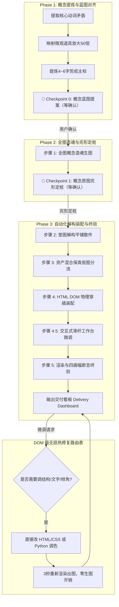

# 超现实复古剪贴封面引擎

本技能采用“全图先行造魂，垫图解构切片，物理多端复刻”的现代 AI 视觉工程架构。文字本身作为复古剪纸实体元件直接由模型生成并拆解，在 HTML 中实现自适应多画幅高质感物理装配。

通过【三阶段执行、双检查点对齐、DOM 级秒级无损热修复】现代化交互范式，彻底摒弃盲目单向狂奔，在概念与构图关键节点前置对齐用户意图，拦截构图缺陷与算力浪费。

## 上下文指针索引

- 美学范式、空间拓扑与四端画幅避让安全区规范：`references/aesthetic-matrix.md`
- 全图概念造魂与平铺解构提示词（解耦两大分支）：`references/prompts/prompts-concept-hero.md`
- 1930s 复古亚麻牛皮纸底纸提示词：`references/prompts/prompts-canvas.md`
- 真实手工剪裁几何色块提示词：`references/prompts/prompts-color-blocks.md`
- 超现实隐喻异质道具提示词：`references/prompts/prompts-props.md`
- 复古剪纸实体素材提示词：`references/prompts/prompts-stickers.md`
- Joe Webb 深空圆窗与星系裂隙提示词：`references/prompts/prompts-portals.md`
- 备用特效工具箱目录：`scripts/tools/`

---

## 项目命名空间规范（Workspace Isolation）

所有中间资产、切片素材与装配产物**必须**在 `_inbox/` 建立独立的项目文件夹，严禁直接在 `_inbox/` 根目录下堆放杂乱散件：

```text
_inbox/<slug>_assets/
├── hero_concept.jpg          # 步骤 1：全图概念造魂原图
├── hero_spritesheet.jpg      # 步骤 2：解构平铺散件参考图
├── sprites/                  # 步骤 3：智能抠图提取的透明通道素材库
│   ├── subject.svg           # 矢量化剪纸人像（粉碎 AI 假渐变与塑料感）
│   ├── prop_arch.svg         # 矢量化几何拱门/纯色色块（硬朗手工剪切边）
│   ├── prop_giant.svg        # 矢量化尺度反差道具切片（彻底抹除 AI 指纹）
│   ├── astrolabe.svg         # 古典纯矢量蚀刻天球星盘
│   └── title_papercut.svg    # 矢量化实体文字剪纸元件
├── <slug>.html               # 步骤 4：物理穿插自适应 HTML 装配源码
├── <slug>_workbench.html     # 步骤 4.5：交互式滑杆调优工作台（滑杆确认细节，一键复制位置）
├── <slug>_2115x900.png       # 步骤 5：微信公众号全宽封面（2.35:1）
├── <slug>_900x900.png        # 步骤 5：微信消息列表缩略仿真（1:1）
├── <slug>_1920x1080.png      # 步骤 5：标准宽屏/B站视频封面（16:9）
└── <slug>_1440x1920.png      # 步骤 5：小红书高光竖屏封面（3:4）
```

---

## 三阶段与双检查点交互架构



---

## 阶段执行详述

### Phase 1：概念提炼与蓝图对齐

在动用生图算力之前，必须先读懂文章、完成哲学意象映射，并给出概念提案。

1. **提取核心动词矛盾**：提炼文章核心动作（如观测、解构、裁断、对抗、量化、修复）；
2. **映射微观实体并极端放大 50 倍**：将动作映射为现实中极其微小的复古物件（如裁缝剪刀、黄铜游标卡尺、怀表齿轮、载玻片、复古邮戳、植物压花器等），在画面中放大 50 倍与人物形成荒谬的尺度交互；
3. **精炼剪纸主标题**：凝练 4~6 字核心主标（如《时间之裁》《度量困局》），并构思字条物理材质；
4. **确定美学分支与空间拓扑**：
   - **分支 A**（极简包豪斯矢量剪纸，Bauhaus Minimalist Vector Papercut）：极简几何构成、平坦纯色块面、硬朗矢量轮廓线、克制几何穿插，适合深度思辨、商业哲学、系统架构与理性随笔；
   - **分支 B**（波普平涂矢量拼贴，Pop Vector Cutout Collage）：马蒂斯纯色剪纸、高饱和撞色平涂、硬朗剪刀矢量边缘、波普图形拼贴，适合潮流科技、极客产品、喜剧大喜利；
5. **智能主动检索特效工具箱**（用户感知无负担原则）：
   用户不可能预先知道 Agent 拥有哪些底层脚本。Agent 必须根据文章核心主题，**在规划阶段主动判断并提议最契合的工具**（若都不契合，则坚决不提，保持极简）：
   - **时间冲突**、**系统故障**、**思维撕裂** ➔ 主动提议：选用「河村康辅垂直切片位移」（`shredder_slicer.py`），对主体施加 6px 真实物理纸条错位；
   - **天文宇宙**、**深空哲学**、**理性度量**、**宿命探寻** ➔ 主动提议：选用「古典天球星盘」（`engraving_astrolabe.py`），生成 0.1px 精度的数学铜版刻度层穿插于背景；
   - **其他普通主题** ➔ 保持标准双分支装配，不提任何多余工具。
6. 触发【🛑 Checkpoint 0: 概念蓝图提案】：
   向用户输出以下结构化蓝图卡片，并显式停步等待用户确认或调整选项：

```markdown
> [!IMPORTANT]
> ### 🛑 Checkpoint 0: 概念蓝图提案（请确认后再动笔）
> 
> - **剪纸主标题**：《4~6字主标》（副标题：一句话补充）
> - **核心动作与隐喻**：[提炼的动词] → [微观道具] 放大 50 倍（作为人物攀登/对抗/倚靠的实体）
> - **美学分支推荐**：[分支 A 极简包豪斯矢量剪纸 / 分支 B 波普平涂矢量拼贴]（理由说明）
> - **空间拓扑预设**：[Toon Joosen 文字地质台基 / Joe Webb 负空间深空穿透]
> - **主动提议增强工具**：[无 / 推荐河村康辅碎纸位移 / 推荐古典天球星盘]（若无则显示“纯物理纸艺标准装配”）
> - **预定命名空间**：`_inbox/<slug>_assets/`
> 
> *请回复确认，或提出想微调的主题词、隐喻道具与画风倾向。确认后将立即执行全图造魂。*
```

---

### Phase 2：全图造魂与完形定桩

用户确认蓝图后，进入概念定桩阶段。

#### 步骤 1 全图概念造魂（解耦两大纯正 SVG 矢量分支）
调用生图工具生成一张具备完整完形感、超现实尺度冲突与纯正矢量剪纸美学的高清概念原图。

在生成提示词的第一句中，**必须**显式声明全量适配 SVG 矢量化的美学分支（彻底剔除报纸半色调网点与微观雕刻线）：
- **分支 A**（极简包豪斯矢量剪纸）：`A minimalist vector papercut collage in the style of Bauhaus geometric posters, Saul Bass, and Toon Joosen: Style Declaration: Bauhaus Minimalist Vector Papercut, flat SVG silkscreen illustration, bold flat color planes, razor-sharp vector contours, zero halftone dots...`；
- **分支 B**（波普平涂矢量拼贴）：`A surreal pop vector cutout collage in the style of Henri Matisse paper cutouts and modern Pop Art screenprint graphics: Style Declaration: Pop Art Vector Collage, flat SVG vector illustration, vibrant high-contrast flat color blocking, zero halftone dots...`。

通用的全图构建红线：
- **文字作为物理剪纸元件**：在提示词中显式指定将主标题文字作为物理剪纸字条、木刻活字块直接融入画面，使其成为承重台阶或画面核心构件；
- **纯净视觉红线**：严禁伪拉丁乱码、严禁无意义水印与边角装饰性小字；
- 产物写入：`_inbox/<slug>_assets/hero_concept.jpg`。

#### 触发【🛑 Checkpoint 1：概念原图完形定桩】
生成原图后，**严禁立即执行散件切片**！必须展示原图，执行专业自检，并向用户交付定桩卡片：

```markdown
> [!IMPORTANT]
> ### 🛑 Checkpoint 1: 概念原图完形定桩（构图拦截审查）
> 
> 概念原图已生成完毕：`_inbox/<slug>_assets/hero_concept.jpg`
> 
> | 审查维度 | 质检状态 | 专业评估说明 |
> | :--- | :---: | :--- |
> | **尺度反差张力** | ✅ 通过 | 50倍放大道具与人物形成强烈的超现实身体交互 |
> | **美学质感纯度** | ✅ 通过 | 完整呈现老报刊油印网点/手工剪刀平直切痕，无二次元模切白边 |
> | **物理文字物性** | ✅ 通过 | 主标题自然融入画面物理台基，无浮空数码字幕感 |
> | **视觉纯净度** | ✅ 通过 | 彻底杜绝伪英文乱码、期号标签、无意义印章与装饰边角杂质 |
> 
> *请审查原图构图与视觉张力。若满意请回复“定桩”，我们将启动垫图拆解与多端物理装配；若构图不理想可在此免费重生成。*
```

---

### Phase 3：自动化解构装配与终验

用户确认定桩后，流水线进入自动化资产拆解、保真分流与多画幅自适应装配。

#### 步骤 2 垫图解构平铺散件（Knolling Spritesheet）
以 `_inbox/<slug>_assets/hero_concept.jpg` 为参考图，提示生图模型将其展开为纯白底平铺散件图：
- 严格遵循 `references/prompts/prompts-concept-hero.md` 中对应分支的解构平铺提示词模板；
- 散件之间保持清晰间距，严禁相互重叠；
- 产物写入：`_inbox/<slug>_assets/hero_spritesheet.jpg`。

#### 步骤 3 智能无损抠图与全图元分层矢量化（抹除 AI 指纹）
在复古剪纸拼贴（Papercut / Retro Collage）中，所有视觉图元（人物肖像、道具、文字条、建筑拱门）物理本质上均是由剪刀剪切出来的印刷品实体纸片。AI Diffusion 扩散模型生成的原始点阵带有强烈的数字假渐变、塑料光泽与生物学微特征。为了**彻底抹除 AI 指纹**，运行 `scripts/cutout_asset.py` 提取透明通道，**所有解构图元一律默认 100% 执行 SVG 矢量化切片**：

1. **解构图元默认全量矢量化切片**（人物、道具、文字条、建筑拱门）：
   ```bash
   python .agents/skills/collage-cover-maker/scripts/cutout_asset.py "_inbox/<slug>_assets/sprites/<raw>.png" "_inbox/<slug>_assets/sprites/<clean>.png" --vectorize --export-svg "_inbox/<slug>_assets/sprites/<clean>.svg" --k-clusters 10
   ```
   *核心价值：通过双边滤波平坦化与 Lab 空间色阶聚类（K-Means），将 AI 虚假微渐变粉碎为硬朗色块，提取带物理剪刀多边形折线轮廓的纯矢量 SVG。从几何层面上物理级粉碎 AI 指纹，呈现出纯正的包豪斯与复古丝网印剪纸质感。*

2. **背景层与特效装配**：
   - 画布底层背景（如整张无缝亚麻卡纸底纹、整幅全景深空）作为基础承托层；
   - 若画面融入宇宙星空，显式调用备用工具箱生成金铜色矢量天球星盘：
     ```bash
     python .agents/skills/collage-cover-maker/scripts/tools/engraving_astrolabe.py --output "_inbox/<slug>_assets/sprites/astrolabe.svg" --size 1200 --ink-color "#1A1715" --gold-color "#B88E3E"
     ```
     以 0.1px 绝对严谨的数学刻度环对撞混沌深空，注入复古理性美感。

3. **防元指令泄露铁律**（严禁说教与自我辩解）：
   - 严禁在给用户的输出中搬弄规则、生成类似“为什么不能矢量化”的教条式解释与辩解 Note；
   - 严禁声称人像、麦克风、纸带“严禁矢量化”——所有前景拼贴图元均应当遵循矢量化规则以消除 AI 假质感。

#### 步骤 4 HTML DOM 物理装配（规避横屏粗糙撕纸）
在 `_inbox/<slug>_assets/<slug>.html` 编写物理穿插 DOM 布局，自适应四画幅：
- **横屏排版底座铁律**（彻底杜绝横屏粗糙撕纸）：
  - **严禁**在 2.35:1 与 16:9 横屏中横贯一条宽达 2200px 的粗糙锯齿撕纸白条；
  - 必须采用以下优雅形式之一：
    1. **方案 A**（直切卡纸条）：平整直裁的米白卡纸条或深色矩形地平线，宛如经典图书腰封；
    2. **方案 B**（底纸直接排版）：文字以思源宋体直接排在古董亚麻做旧底纸上，搭配自然侧光落差阴影；
    3. **方案 C**（紧凑剪纸字块）：字条宽度贴合文字收紧，两翼保留宏大纯净呼吸留白；
    4. **方案 D**（实体剪纸嵌入）：直接嵌入拆解出的标题剪纸图片或 SVG 矢量元件。
- **物理穿插层叠规范**：主标题字条（`z-index: 20`）承托人物下部，斜插隐喻道具（`z-index: 24`），人物主体（`z-index: 30`）自然探出，深空与星盘位于后方负空间，严禁所有文字死板置顶。
- 调用 `render_and_regrain.py` 压入 2048px 画幅与阶调依从型油墨颗粒：
  ```bash
  # 1. 微信公众号 (2.35:1)
  python .agents/skills/collage-cover-maker/scripts/render_and_regrain.py "_inbox/<slug>_assets/<slug>.html" "_inbox/<slug>_assets/<slug>_2115x900.png" 2115 900

  # 2. 微信 1:1 正方形缩略视窗 (900x900)
  python .agents/skills/collage-cover-maker/scripts/render_and_regrain.py "_inbox/<slug>_assets/<slug>.html" "_inbox/<slug>_assets/<slug>_900x900.png" 900 900

  # 3. 标准宽屏/B站 (16:9)
  python .agents/skills/collage-cover-maker/scripts/render_and_regrain.py "_inbox/<slug>_assets/<slug>.html" "_inbox/<slug>_assets/<slug>_1920x1080.png" 1920 1080

  # 4. 小红书图文 (3:4)
  python .agents/skills/collage-cover-maker/scripts/render_and_regrain.py "_inbox/<slug>_assets/<slug>.html" "_inbox/<slug>_assets/<slug>_1440x1920.png" 1440 1920
  ```

#### 步骤 4.5 生成交互式滑杆调优工作台（确认前端细节）

装配 HTML 编写完毕后，运行 `generate_workbench.py` 生成独立的纯前端交互界面（`_workbench.html`），供用户或 Agent 在浏览器中零代码直观调整构图细节：

```bash
python .agents/skills/collage-cover-maker/scripts/generate_workbench.py "_inbox/<slug>_assets/<slug>.html"
```

核心微调能力与交互特性：
1. **全图元滑杆实时精调**：
   - 水平位移（X）与垂直位移（Y）：支持滑杆调节、数字框精确输入与画布直接拖拽，方向键支持 1px 精调（Shift + 方向键 10px）；
   - 尺寸缩放（Scale）与旋转角度（Rotate）：微调道具倾角与人物尺度，打破 AI 僵硬死板的对齐；
   - 图层层叠（Z-Index）与不透明度（Opacity）：解决星盘、前景与主标题的穿插遮挡关系；
   - 物理纸张微距投影（Drop-Shadow）：独立调节偏移偏角（Offset X/Y）、漫反射模糊（Blur）与纸厚立体感；
2. **多端安全视窗实时仿真**：
   - 微信 1:1 正方形安全视窗覆盖层（900×900）：两侧半透明阴影遮罩，一目了然看清微信信息流列表抓取时的裁切边缘，确保标题文字与核心面部零截断；
   - 居中十字参考线与视窗缩放：支持自适应屏幕尺寸与 100% 原始像素仿真；
3. **一键复制合适的位置**：
   - 界面右上角醒目常驻“**一键复制合适的位置**”按钮；
   - 点击即可将微调后的 CSS 绝对坐标或更新后的完整 HTML 源码写入剪贴板，直接粘贴回装配文件或提供给 AI，零生图成本秒级完成构图终验。

#### 步骤 5 四画幅硬指标断言与多模态终验
运行 `verify_cover.py` 自动化核验物理分辨率、Inbox 路径、DOM 拓扑穿插、白边禁用与无用小标签禁用：
```bash
python .agents/skills/collage-cover-maker/scripts/verify_cover.py "_inbox/<slug>_assets/<slug>_2115x900.png" --html "_inbox/<slug>_assets/<slug>.html" --preset 2.35:1
python .agents/skills/collage-cover-maker/scripts/verify_cover.py "_inbox/<slug>_assets/<slug>_900x900.png" --preset 1:1
python .agents/skills/collage-cover-maker/scripts/verify_cover.py "_inbox/<slug>_assets/<slug>_1920x1080.png" --preset 16:9
python .agents/skills/collage-cover-maker/scripts/verify_cover.py "_inbox/<slug>_assets/<slug>_1440x1920.png" --preset 3:4
```
显式调用 `read_file` 审查微信中央 1:1（900×900）缩略视窗文字完整性与横屏地平线雅致度。

---

## DOM 级无损热修复路由表（In-flight Hot-Patching Router）

当用户在装配或终验阶段提出微调意见时，**严禁重跑扩散模型重新生图**！
拼贴工程的核心优势在于“物理资产解耦与 DOM 装配”。任何视觉微调必须通过下述路由表在 3 秒内秒级无损更新：

| 用户微调诉求 | 传统错误做法（严禁） | DOM 级无损热修复手段（3秒生效） | 对应修改文件与参数 |
| :--- | :--- | :--- | :--- |
| **标题文字微调**<br>（改字/调字距/行高/颜色） | 重新跑 Midjourney / SD 生图 | 直接修改 HTML 中 `.title-text` 的文字、`letter-spacing` 或 `color` | `<slug>.html` 内 CSS 样式 |
| **道具与人物姿态**<br>（倾斜角度/大小/左右位移） | 重新抽卡生图重新切图 | 直接调整对应元素的 CSS `transform`（`rotate(-8deg)` / `translate(20px, -15px)` / `scale(1.1)`） | `<slug>.html` 内对应图元 `style` |
| **空间层级冲突**<br>（文字被挡住/人物要踩在字上） | 重新抠图合成 | 直接修改对应图元的 `z-index` 层叠数值 | `<slug>.html` 内各图元 `z-index` |
| **星盘效果微调**<br>（太亮抢戏/颜色不搭） | 重新写提示词生图 | 调整 CSS `opacity`（`0.4 ~ 0.7`）或重新生成不同墨色的星盘 SVG | `style="opacity: 0.55;"` 或 `engraving_astrolabe.py` 参数 |
| **底纸色温与颗粒**<br>（太黄/太暗/噪点太重） | 重做整张底纸 | 修改 HTML 背景色值（如 `#F4EFEA` 改为 `#EAE5DD`）或渲染脚本的 `--noise_sigma` | `<slug>.html` 或 `render_and_regrain.py` 调用参数 |

> [!TIP]
> **热修复与实时出图**：在浏览器中打开 `_workbench.html` → 拖动滑杆微调或在画布直接拖拽零件 → 满意后可直接点击顶部 📸 **导出高清封面**（PNG）或 🔲 **导出方形视窗图** 在本地即时下载 2115×900 与 900×900 真实图片文件；亦可点击 📋 **一键复制合适的位置** 将 CSS 坐标贴回生产模板 `<slug>.html` 永久归档。零生图 Token 开销，100% 保持构图一致性。

---

## 交付看板规范（Delivery Dashboard）

完成步骤 5 的四画幅断言与自检后，必须向用户输出包含微信 1:1 视窗仿真与纯净度清单的标准交付看板：

```markdown
### 🎨 超现实复古剪贴封面交付看板

#### 1. 多画幅高清成品清单
- 📱 **微信公众号全宽**（2.35:1，2115×900）：`_inbox/<slug>_assets/<slug>_2115x900.png`
- 🔲 **微信正方形缩略视窗仿真**（1:1，900×900）：`_inbox/<slug>_assets/<slug>_900x900.png`
- 🖥️ **标准宽屏与视频封面**（16:9，1920×1080）：`_inbox/<slug>_assets/<slug>_1920x1080.png`
- 📕 **小红书高光竖屏封面**（3:4，1440×1920）：`_inbox/<slug>_assets/<slug>_1440x1920.png`

#### 2. 微信 1:1 视窗裁切仿真与安全区自检
> [!NOTE]
> 微信消息列表抓取水平正中央 900×900 区域。经仿真校验：
> - 主标题文字完全收敛于中央视窗内（两侧各留有 >40px 安全留白，无裁切风险）；
> - 人物核心面部神态与 50 倍放大隐喻道具在 1:1 视窗内形成自洽平衡的独立紧凑构图。

#### 3. 视觉纯净度与工程合规六项核验
- [x] **无粗糙横贯撕纸**：横屏采用平整直切卡纸条地平线，呼吸感开阔；
- [x] **无虚假装饰杂质**：无 `VOL.` 期号贴纸、无伪英文打字机小字、无 Fake 印章；
- [x] **无二次元数码白边**：切片紧贴手工剪纸物理边缘，无发光模切白圈；
- [x] **全图元矢量化抹除 AI 指纹达标**：解构图元（人物、道具、字条、拱门）全部通过 Lab 聚类导出为 SVG 矢量剪纸元件；
- [x] **物理层叠空间咬合**：地质台基承托人物下部，道具穿插斜跨，无死板文字置顶；
- [x] **落点隔离合规**：所有生产资料与切片素材收拢于 `_inbox/<slug>_assets/` 独立命名空间。

*如需微调文字位置、旋转角度、星盘透明度或底纸冷暖，只需告知具体诉求，我们将通过 DOM 无损热修复秒级出图！*
```

---

## 备用特效工具箱（Standby Tools）

在 `scripts/tools/` 目录下备有 3 个开箱即用的专业特效工具，用于处理高阶定制化剪纸拼贴视觉：

### 1. 河村康辅式碎纸机垂直切片位移工具（`shredder_slicer.py`）
- **触发场景**：当封面需要强化冲突感、时间裂隙、记忆碎片或赛博波普感时，对前景人物或主体应用碎纸切片位移特效。支持单图错位或前景主体与背景宇宙/星空交织穿插；
- **调用命令**：
  ```bash
  # 单图切片错位位移（模拟物理碎纸机与纸条侧边高光阴影）
  python .agents/skills/collage-cover-maker/scripts/tools/shredder_slicer.py --input "_inbox/<slug>_assets/sprites/<subject>.png" --output "_inbox/<slug>_assets/sprites/<subject_shredded>.png" --strip-width 6 --displacement 35

  # 前景主体与宇宙背景交织穿插碎纸拼贴
  python .agents/skills/collage-cover-maker/scripts/tools/shredder_slicer.py --input "_inbox/<slug>_assets/sprites/<subject>.png" --background "_inbox/<slug>_assets/sprites/<galaxy>.jpg" --output "_inbox/<slug>_assets/sprites/<composite_shredded>.png" --strip-width 6 --displacement 35
  ```

### 2. 古典蚀刻星盘与铜版图腾生成器（`engraving_astrolabe.py`）
- **触发场景**：文章主题涉及科学宇宙、时间哲学、天文历法或历史命运时，一键生成高精度纯矢量铜版蚀刻星盘与黄道带天球图腾，注入古典科学理性美感；
- **调用命令**：
  ```bash
  # 生成高精度透明底天文星盘 SVG
  python .agents/skills/collage-cover-maker/scripts/tools/engraving_astrolabe.py --output "_inbox/<slug>_assets/sprites/astrolabe.svg" --size 1200 --ink-color "#1A1715" --gold-color "#B88E3E"
  ```

### 3. 通用古典 45 度胶印半色调网点滤镜（`halftone_screen.py`）
- **触发场景**：当现代图片、普通照片、真实素材或解构元件需要迅速回退到 1950s 真实报纸半色调胶印印刷质感时，施加该网点滤镜；
- **调用命令**：
  ```bash
  # 将普通图像转换为 1950s 胶印半色调网点（保留 Alpha 透明通道与面部神态）
  python .agents/skills/collage-cover-maker/scripts/tools/halftone_screen.py --input "_inbox/<slug>_assets/sprites/<raw_asset>.png" --output "_inbox/<slug>_assets/sprites/<asset_halftone>.png" --dot-freq 0.55 --blend 0.72 --ink-color "20,22,24" --paper-tone "246,242,238"
  ```
