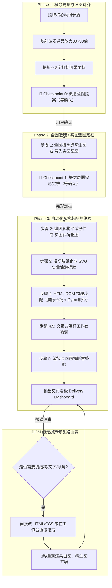

# 现代混合编辑拼贴封面引擎（Selman Hoşgör 体系）

本技能采用“现代画报编辑拼贴，实图/全图造魂，垫图解构切片，物理多端复刻”的现代 AI 视觉工程架构。将核心人物转化为具有真实微观细节的**冲压模切贴纸**，背景对撞**即兴高饱和丙烯厚涂**与**随性手绘黑色马克笔涂鸦**，标题采用 **Dymo 实体打标机胶带** 动态微倾排版，在 HTML 中实现自适应多画幅高质感物理装配。

通过【三阶段执行、双检查点对齐、DOM 级秒级无损热修复】现代化交互范式，在概念与构图关键节点前置对齐用户意图，拦截构图缺陷与算力浪费。

## 上下文指针索引

- 美学范式、零 AI 指纹保障与四端画幅避让安全区规范：`references/aesthetic-matrix.md`
- 全图概念造魂与平铺解构提示词：`references/prompts/prompts-concept-hero.md`
- 现代展陈暖白卡纸与零 AI 指纹底纸规范：`references/prompts/prompts-canvas.md`
- 现代写实摄影模切贴纸提示词规范：`references/prompts/prompts-stickers.md`
- 超现实隐喻异质道具提示词：`references/prompts/prompts-props.md`
- 备用特效工具箱目录：`scripts/tools/`

---

## 项目命名空间规范（Workspace Isolation）

所有中间资产、切片素材与装配产物**必须**在 `_inbox/` 建立独立的项目文件夹，严禁直接在 `_inbox/` 根目录下堆放杂乱散件：

```text
_inbox/<slug>_assets/
├── hero_concept.jpg          # 步骤 1：全图概念造魂原图（若用实图则为 real_source.png）
├── hero_spritesheet.jpg      # 步骤 2：解构平铺散件参考图
├── sprites/                  # 步骤 3：透明通道与矢量素材库
│   ├── subject_sticker.png   # 真实摄影带 5px 纯白模切边与微投影贴纸
│   ├── brush_smears.svg      # 电光钴蓝/荧光柠檬黄动态丙烯厚涂切片
│   ├── marker_doodles.svg    # 黑色手绘马克笔涂鸦切片（闪电、螺旋圈、笑脸）
│   └── prop_giant.svg        # 矢量化尺度反差道具切片
├── <slug>_2115x900.html      # 步骤 4：微信 2.35:1 物理装配源码
├── <slug>_1920x1080.html     # 步骤 4：标准宽屏 16:9 装配源码
├── <slug>_1440x1920.html     # 步骤 4：小红书 3:4 竖屏装配源码
├── <slug>_workbench.html     # 步骤 4.5：交互式滑杆调优工作台（画布拖拽，一键复制位置）
├── <slug>_2115x900.png       # 步骤 5：微信公众号全宽封面（2.35:1）
├── <slug>_900x900.png        # 步骤 5：微信消息列表缩略仿真（1:1）
├── <slug>_1920x1080.png      # 步骤 5：标准宽屏/B站视频封面（16:9）
└── <slug>_1440x1920.png      # 步骤 5：小红书高光竖屏封面（3:4）
```

---

## 三阶段与双检查点交互架构



---

## 阶段执行详述

### Phase 1：概念提炼与蓝图对齐

在动用生图算力之前，必须先读懂文章、完成哲学意象映射，并给出概念提案。

1. **提取核心动词矛盾**：提炼文章核心动作（如观测、解构、争辩、校准、对撞）；
2. **映射微观实体并极端放大 30~50 倍**：将动作映射为现实中极其微小的日常物件（如抢答台铃、工业游标卡尺、木工铅笔、软盘等），在画面中放大与人物形成荒谬的尺度交互；
3. **精炼打标胶带主标题**：凝练 4~8 字核心主标（如《直到脑中观众笑出声来》《度量困局》），并构思副标；
4. **统一美学范式**：
   - 纯正 **Selman Hoşgör 现代混合拼贴**：写实摄影肖像模切贴纸 + 即兴高饱和丙烯厚涂（钴蓝/柠檬黄/亮粉） + 黑色手绘马克笔涂鸦 + Dymo 实体打标机黑胶带；
5. 触发【🛑 Checkpoint 0: 概念蓝图提案】：
   向用户输出结构化蓝图卡片，并显式停步等待用户确认或调整选项：

```markdown
> [!IMPORTANT]
> ### 🛑 Checkpoint 0: 概念蓝图提案（请确认后再动笔）
> 
> - **打标胶带主标**：《4~8字主标》（副标题：一句话补充）
> - **核心动作与隐喻**：[提炼的动词] → [微观道具] 放大 30~50 倍
> - **主体形式**：[实图原片代码抠图模切贴纸 / AIGC 生成写真模切贴纸]（保留真实摄影质感，绝不压成纯色）
> - **丙烯与涂鸦配置**：电光钴蓝 + 荧光柠檬黄即兴厚涂，黑色马克笔脑波闪电涂鸦
> - **底板基底**：现代画廊展陈暖白卡纸（#F7F5F0，纯 CSS 零 AI 指纹）
> - **预定命名空间**：`_inbox/<slug>_assets/`
> 
> *请回复确认，或提出想微调的主题词、隐喻道具与画风倾向。确认后将立即执行全图造魂。*
```

---

### Phase 2：全图造魂与完形定桩

用户确认蓝图后，进入概念定桩阶段。

#### 步骤 1 全图概念造魂（或实图垫图）
- **路线 A（AIGC 生图）**：调用生图工具生成具备完整完形感与现代波普编辑美学的高清概念原图，严格遵循 `references/prompts/prompts-concept-hero.md`。
- **路线 B（实图垫图，100% 零 AI 指纹）**：若用户提供了真实剧照、活动照片或视频截图（如影视剧照、综艺截图），直接将其作为核心基准，跳过生图模型。

#### 触发【🛑 Checkpoint 1：概念原图完形定桩】
向用户展示原图/实图，审查构图重心与主体神态。

---

### Phase 3：自动化解构装配与终验

用户确认定桩后，流水线进入自动化资产拆解、保真分流与多画幅自适应装配。

#### 步骤 2 散件解构平铺 / 实图代码抠图
- **若为 AIGC 路线**：以概念图为参考垫图，展开为纯白底平铺散件图（`hero_spritesheet.jpg`）；
- **若为实图路线**：直接运行代码抠图算法（RMBG-ONNX / BiRefNet / rembg），仅计算透明通道 Alpha 遮罩，100% 保留相机原生 CMOS 像素与光电散粒噪声。

#### 步骤 3 模切贴纸化与矢量图元提取
1. **人物模切贴纸化（Die-cut Sticker）**：
   通过形态学椭圆核膨胀外扩 5px 实体纯白模切边，并附加自然微距柔和投影与发丝边缘 Alpha 平滑混合；
2. **纯矢量装饰图元（Zero AI Fingerprint）**：
   丙烯厚涂色块（`brush_smears.svg`）与手绘马克笔涂鸦（`marker_doodles.svg`）统一采用纯 SVG 矢量代码生成，杜绝外部位图依赖。

#### 步骤 4 HTML DOM 物理装配
在 `_inbox/<slug>_assets/` 编写物理穿插 DOM 布局：
- **背景层**：采用现代画廊展陈暖白卡纸（#F7F5F0）+ 内联 SVG 纸浆微噪点；
- **穿插层叠规范**：丙烯笔刷（`z-index: 15`）在后，马克笔涂鸦（`z-index: 18`）穿插四周，人物贴纸（`z-index: 22`）居中凸显，放大道具（`z-index: 26`）斜插，Dymo 打标黑胶带主标（`z-index: 32`，倾斜 -2.5°）横跨于前；
- 调用 `render_and_regrain.py` 渲染并注入细腻油墨阶调颗粒：
  ```bash
  # 1. 微信公众号 (2.35:1)
  python .agents/skills/collage-cover-maker/scripts/render_and_regrain.py "_inbox/<slug>_assets/<slug>_2115x900.html" "_inbox/<slug>_assets/<slug>_2115x900.png" 2115 900

  # 2. 标准宽屏/B站 (16:9)
  python .agents/skills/collage-cover-maker/scripts/render_and_regrain.py "_inbox/<slug>_assets/<slug>_1920x1080.html" "_inbox/<slug>_assets/<slug>_1920x1080.png" 1920 1080

  # 3. 小红书图文 (3:4)
  python .agents/skills/collage-cover-maker/scripts/render_and_regrain.py "_inbox/<slug>_assets/<slug>_1440x1920.html" "_inbox/<slug>_assets/<slug>_1440x1920.png" 1440 1920
  ```
- 裁切微信 1:1 正方形缩略视窗（`900×900`）。

#### 步骤 4.5 生成交互式滑杆调优工作台
运行 `generate_workbench.py` 生成独立的纯前端交互界面（`_workbench.html`）：
```bash
python .agents/skills/collage-cover-maker/scripts/generate_workbench.py "_inbox/<slug>_assets/<slug>_2115x900.html"
```
用户可在浏览器中直接拖拽贴纸、涂鸦、道具与文字，微调倾角与缩放，并实时核对微信 1:1 正方形安全视窗。点击“一键复制合适的位置”秒级同步。

#### 步骤 5 四画幅硬指标断言与多模态终验
运行 `verify_cover.py` 自动化核验物理分辨率、Inbox 路径、DOM 拓扑穿插与安全视窗完整性。

---

## DOM 级无损热修复路由表（In-flight Hot-Patching Router）

| 用户微调诉求 | 传统错误做法（严禁） | DOM 级无损热修复手段（3秒生效） | 对应修改文件与参数 |
| :--- | :--- | :--- | :--- |
| **标题文字微调** | 重新跑生图模型 | 直接修改 HTML 中 `.dymo-main` 的文字或 CSS | HTML 源码或工作台 |
| **道具与贴纸姿态** | 重新抽卡生图 | 工作台直接拖拽，或修改 CSS `transform: rotate(...)` | HTML 源码或工作台 |
| **空间层级冲突** | 重新抠图合成 | 直接修改对应图元的 `z-index` | HTML 源码 |
| **丙烯与涂鸦微调** | 重新写提示词 | 修改 SVG 内的 fill 颜色或路径坐标 | SVG 源码 |
| **底纸色温微调** | 重做整张底纸 | 修改 HTML 背景色值（如 `#F7F5F0` 改为 `#F2EFE9`） | HTML 源码 |

---

## 交付看板规范（Delivery Dashboard）

完成步骤 5 的四画幅断言后，输出标准交付看板：
- 📱 **微信公众号全宽**（2.35:1，2115×900）：`_inbox/<slug>_assets/<slug>_2115x900.png`
- 🔲 **微信正方形缩略视窗**（1:1，900×900）：`_inbox/<slug>_assets/<slug>_900x900.png`
- 🖥️ **标准宽屏与视频封面**（16:9，1920×1080）：`_inbox/<slug>_assets/<slug>_1920x1080.png`
- 📕 **小红书高光竖屏封面**（3:4，1440×1920）：`_inbox/<slug>_assets/<slug>_1440x1920.png`
- 🛠️ **交互式微调工作台**：`_inbox/<slug>_assets/<slug>_workbench.html`
